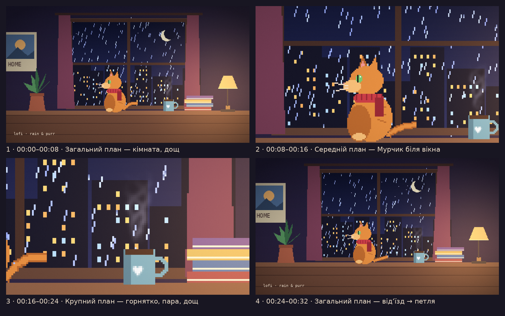

# Rain & Purr — Lo-Fi AI Video

**Формат:** Lo-Fi Video. Це мінімалістичне loop-відео з повільним, ненапруженим рухом.
**Тривалість:** петля 32 с (безшовна) і вертикальна версія для Shorts/Reels. Довшу версію можна зібрати однією командою (див. «Монтаж»).



| Файл | Формат | Призначення |
|---|---|---|
| `output/rain_and_purr_loop_16x9.mp4` | 1920×1080, 24 fps, 0:32 | основна безшовна петля |
| `output/rain_and_purr_shorts_9x16.mp4` | 1080×1920, 0:32 | Reels / Shorts / TikTok |

---

## 1. Ідея

Нічна кімната, за вікном дощ і вогні міста. Рудий кіт **Мурчик** у червоному шарфі сидить на столі й дивиться у вікно. Поруч парує горнятко, а настільна лампа світить теплим світлом.

**Емоція:** затишок і безпека. Надворі холодно й мокро, а вдома тепло. Відео задумане як фон для навчання, роботи чи відпочинку, тож у ньому немає сюжету. Глядач має просто захотіти «залишитись тут ще трохи».

**Меседж:** «Можна просто посидіти й послухати дощ».

## 2. Сценарій (розкадровка)

Lo-Fi передбачає одну локацію й мінімум подій, тому драматургію тримають зміна планів, рух камери й поступове «наростання» музики.

| # | Час | План | Камера | Що відбувається в кадрі | Звук |
|---|---|---|---|---|---|
| 1 | 00:00–00:08 | Загальний | повільний наїзд (zoom 1.18→1.28) | вся кімната: вікно, дощ, місто, кіт, лампа, рослина | дощ, вініл, акорди Rhodes; з 5-ї с вступають барабани |
| 2 | 00:08–00:16 | Середній | плавна панорама вправо | Мурчик дихає, кліпає, ворушить вухом і хвостом, за вікном мерехтять вікна будинків | вступає мелодія, тихе муркотіння кота |
| 3 | 00:16–00:24 | Крупний | легкий дрейф угору | пара над горнятком, краплі дощу, хвіст у кадрі | повний біт |
| 4 | 00:24–00:32 | Загальний | відʼїзд (1.40→1.18) | повертаємося до кадру №1, тому склейка петлі непомітна | біт, петля замикається |

Переходи між сценами зроблені мʼяким крос-фейдом 0.5 с. Різких склейок немає, бо цього вимагає жанр.

## 3. Генерація

**Консистентність.** Усі 4 плани знято «віртуальною камерою» з однієї намальованої сцени. Тому персонаж, локація, палітра й світло фізично ті самі в кожному кадрі.

**Паспорт персонажа «Мурчик»:**
- рудий таббі-кіт, профіль ліворуч, сидить;
- **червоний вʼязаний шарф**, кінчик якого коливається (це впізнавана деталь, як «якір» у референсі персонажа);
- зелені очі, світлий писок, смужки на спині.

**Анімація (усе циклічне в межах 32 с):**
- дихання (4-секундний цикл), хвіст, кінчик шарфа;
- кліпання двічі за петлю, одне посмикування вухом;
- дощ: 140 крапель, кожна робить ціле число «прольотів» за петлю, тому петля безшовна;
- краплі на склі, мерехтіння вікон міста й зірок;
- пара з горнятка, листя рослини, штори;
- ледь помітне мерехтіння лампи й теплий glow;
- кіно-зерно та віньєтка.

**Техніка.** Pixel-art світ 480×270 малюється кодом (`src/render_video.py`, Python + Pillow + NumPy). Віртуальна камера кадрує загальний, середній і крупний плани й вибирає пікселі точково, без білінійного розмиття, із суперсемплінгом 2×2. Тому краї чіткі навіть у крупному плані. Готове відео має 768 кадрів.

> Відео згенероване кодом, який написав AI-асистент (Claude). Генеративні відеомоделі на кшталт Kling, Runway чи Veo тут не використовувались. Якщо курс вимагає саме їх, нижче є промпти, з якими той самий сценарій можна відтворити в цих сервісах.

**Промпти для відтворення в image/video-сервісах (Midjourney / Kling / Runway):**

- *Референс персонажа:*
  `pixel art, orange tabby cat with a red knitted scarf, sitting in profile facing left, green eyes, cozy lofi style, 16-bit, warm lamp light, plain background --ar 1:1`
- *Сцена 1 (загальний):*
  `pixel art lofi room at night, big window with heavy rain and city lights, orange tabby cat in red scarf sitting on a wooden desk looking out the window, steaming blue mug, stack of books, warm table lamp, potted plant, poster on the wall, purple-blue palette, cozy, 16:9`
- *Анімація (image-to-video):*
  `static camera, slow subtle push-in, rain falling outside, cat breathing slowly and blinking, tail gently swaying, steam rising from the mug, city lights flickering, seamless loop, no camera shake`
- *Сцена 2 (середній):* той самий промпт плюс `medium shot, cat at the window`.
- *Сцена 3 (крупний):* `close-up of a steaming blue mug with a heart on a desk, rain on the window behind, bokeh city lights`.

## 4. Голос і звук

Lo-Fi обходиться без озвучення: тут працюють музика й атмосфера. Увесь трек синтезовано з нуля в `src/make_music.py`, без жодного семплу:

- **90 BPM, 12 тактів = рівно 32 с**, тож аудіо петлюється разом із відео;
- акорди **Fmaj7 → Em7 → Dm7 → Cmaj7** звучать тембром електропіаніно (Rhodes-подібний синтез, тремоло, легкий «страм»);
- бас і свінгований біт (kick / snare / hi-hat) вступають на 3-му такті, ледача мелодія вступає на 5-му;
- **муркотіння кота** звучить у середньому плані, коли Мурчик у фокусі;
- дощ (рожевий шум), потріскування вінілу, «теплий» low-pass;
- шов петлі згладжено крос-фейдом 0.25 с.

## 5. Монтаж

- Кадри збираються в H.264 через `ffmpeg` (`-tune animation`, CRF 18, AAC 192k, `faststart`).
- Основний формат **16:9** підходить для YouTube, де lo-fi зазвичай живе.
- Довга версія для YouTube (2:08) збирається без перекодування, вона не лежить у репозиторії через розмір:
  `ffmpeg -stream_loop 3 -i output/rain_and_purr_loop_16x9.mp4 -c copy rain_and_purr_2min.mp4`
- Версія **9:16** рендериться окремо, прямо зі сцени, з власною камерою, наведеною на кота й горнятко. Розтягування горизонтального кадру немає, тому картинка така ж чітка.

### Як перезібрати

```bash
cd ai-video/src
python3 make_music.py ../music.wav
for i in 0 1 2 3; do python3 render_video.py ../frames $((i*192)) $((i*192+192)) 16x9 & done; wait
# вертикальна версія: ... ../frames_v ... 9x16
ffmpeg -framerate 24 -i ../frames/f%04d.png -i ../music.wav -c:v libx264 -crf 18 \
  -pix_fmt yuv420p -tune animation -c:a aac -b:a 192k -shortest ../output/rain_and_purr_loop_16x9.mp4
```
